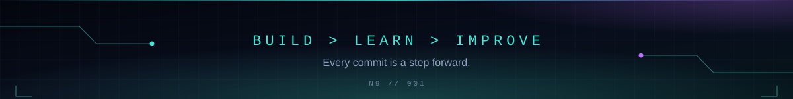

<div align="center">


<br/>

<a href="https://github.com/SANJIT06RAJ"></a>


</div>

<div align="center"></div>

## 01 / ABOUT ME

```python
class Developer:
    name = "NeoByte"
    field = "Information Technology"
    interests = [
        "Backend Development",
        "Full-Stack Engineering",
        "Database Design",
        "Software Testing",
    ]
    mindset = "Learn by building."
```

I'm an IT student focused on turning what I learn into practical software. I enjoy understanding how applications work behind the scenes, designing reliable APIs, working with databases, and improving code through testing.

- 🔭 Currently building **DeadlineOS**
- 🌱 Improving my Python, FastAPI, React, and SQL skills
- 🧪 Practising automated testing, debugging, and Git workflows
- 🎯 Working towards becoming a capable software engineer

<div align="center"></div>

## 02 / TECH STACK

| | |
|:--|:--|
| **Languages** | `Python` `JavaScript` `HTML5` `CSS3` |
| **Frameworks & data** | `FastAPI` `React` `Vite` `SQLite` |
| **Developer tools** | `Git` `GitHub` `Pytest` |

<div align="center"></div>

## 03 / FEATURED PROJECT

### 📚 DeadlineOS

**A better way to manage student assignments and deadlines.**

A student-focused application I'm developing to organise assignments, manage subtasks, and keep track of upcoming deadlines.

| Layer | Technology |
|:--|:--|
| Frontend | React + Vite |
| Backend | Python + FastAPI |
| Database | SQLite |
| Testing | Pytest |

**Current engineering focus**

- Building reliable API endpoints
- Designing relational database structures
- Implementing assignment management features
- Testing application behaviour and database relationships

`STATUS: IN DEVELOPMENT`

<div align="center"></div>

## 04 / GITHUB ANALYTICS

<div align="center">


</div>

<div align="center"></div>

## 05 / CURRENT MISSION

```text
[+] Strengthen software engineering fundamentals
[+] Build practical, maintainable applications
[+] Learn through testing and debugging
[>] Ship better projects and document the process
```

<div align="center">



**[Explore my repositories →](https://github.com/SANJIT06RAJ?tab=repositories)**

</div>
