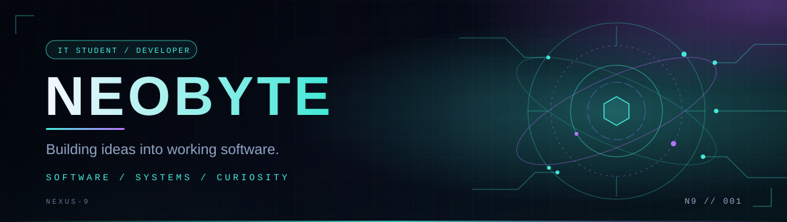

<div align="center">



<br/>


<br/><br/>

<a href="https://github.com/SANJIT06RAJ"></a>


</div>

---

## 👨‍💻 About Me

```python
class Developer:
    name = "NeoByte"
    field = "Information Technology"
    interests = [
        "Backend Development",
        "Full-Stack Engineering",
        "Database Design",
        "Software Testing",
    ]
    mindset = "Learn by building."
```

I'm an IT student focused on turning what I learn into practical software. I enjoy understanding how applications work behind the scenes, designing reliable APIs, working with databases, and improving code through testing.

- 🔭 Currently building **DeadlineOS**
- 🌱 Improving my Python, FastAPI, React, and SQL skills
- 🧪 Practising automated testing, debugging, and Git workflows
- 🎯 Working towards becoming a capable software engineer

---

## 🛠️ Tech Stack

<div align="center">


<br/>


</div>

---

## 🚀 Featured Project

<table>
<tr>
<td width="60%" valign="top">

### 📚 DeadlineOS
**A better way to manage student assignments and deadlines.**

A student-focused application to organise assignments, manage subtasks, and keep track of upcoming deadlines.

**Current focus**
- Building reliable API endpoints
- Designing relational database structures
- Implementing assignment management features
- Testing application behaviour and database relationships

`STATUS: IN DEVELOPMENT`

</td>
<td width="40%" valign="top">

| Layer | Technology |
|-------|------------|
| Frontend | React + Vite |
| Backend | Python + FastAPI |
| Database | SQLite |
| Testing | Pytest |

</td>
</tr>
</table>

---

## 📊 GitHub Analytics

<div align="center">


<br/>


<br/>


</div>

---

## 🎯 Current Mission

```text
[+] Strengthen software engineering fundamentals
[+] Build practical, maintainable applications
[+] Learn through testing and debugging
[>] Ship better projects and document the process
```

<div align="center">

### `BUILD > LEARN > IMPROVE`

*Every commit is a step forward.*

**[Explore my repositories →](https://github.com/SANJIT06RAJ?tab=repositories)**

</div>
