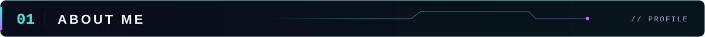
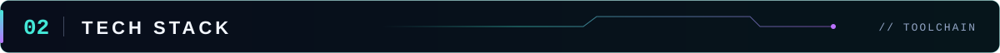
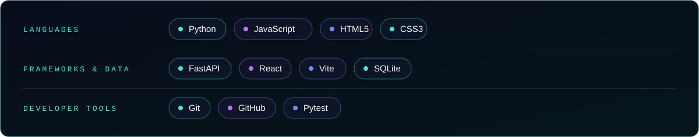
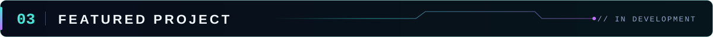
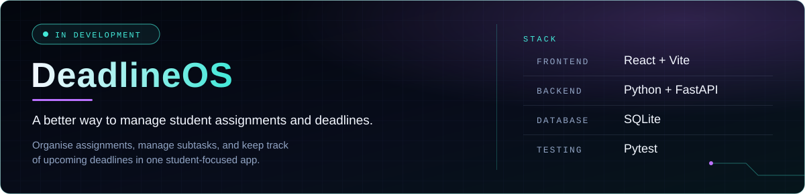
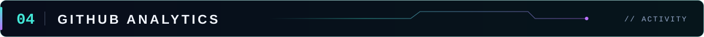
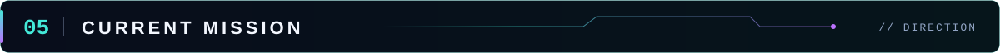
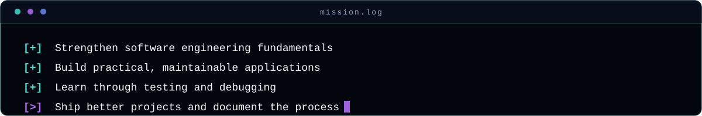

<div align="center">


</div>

<br/>



```python
class Developer:
    name = "NeoByte"
    field = "Information Technology"
    interests = [
        "Backend Development",
        "Full-Stack Engineering",
        "Database Design",
        "Software Testing",
    ]
    mindset = "Learn by building."
```

I'm an IT student focused on turning what I learn into practical software. I enjoy understanding how applications work behind the scenes, designing reliable APIs, working with databases, and improving code through testing.

| | |
|:--|:--|
| 🔭 **Building** | DeadlineOS |
| 🌱 **Improving** | Python, FastAPI, React, and SQL |
| 🧪 **Practising** | Automated testing, debugging, and Git workflows |
| 🎯 **Working towards** | Becoming a capable software engineer |

<br/>





<br/>





**Current engineering focus**

- Building reliable API endpoints
- Designing relational database structures
- Implementing assignment management features
- Testing application behaviour and database relationships

<br/>



<div align="center">


</div>

<br/>





<br/>

<div align="center">


**[Explore my repositories →](https://github.com/SANJIT06RAJ?tab=repositories)**

</div>
